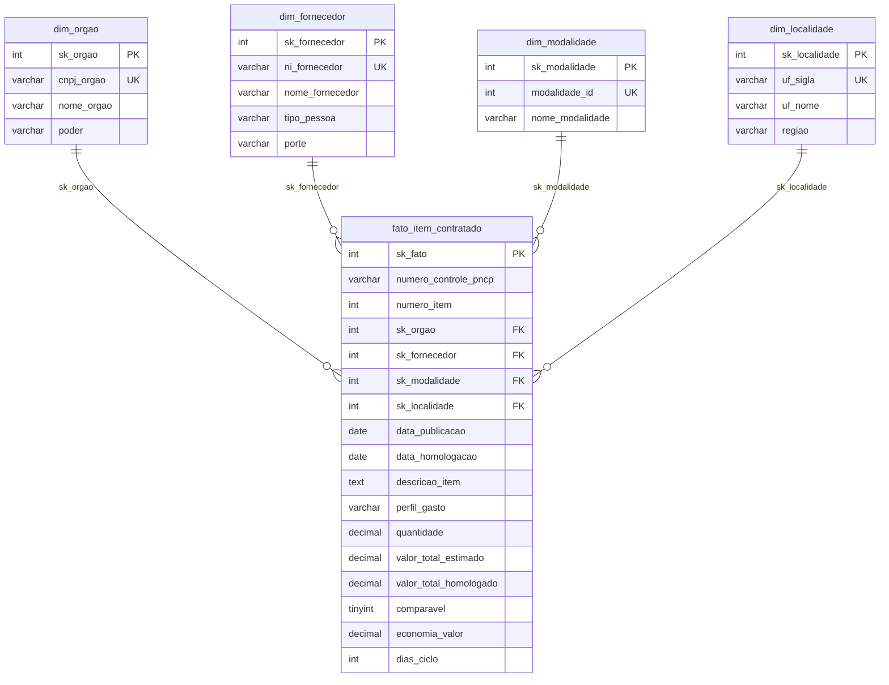

# Análise de Dados com Python + MySQL — Controladoria PNCP

Esteira analítica ponta a ponta (End-to-End) sobre compras e contratações públicas
federais do **Portal Nacional de Contratações Públicas (PNCP)**. O objetivo é
transformar uma base bruta, cheia de inconsistências, em um produto analítico
confiável, auditável e executivo para a Controladoria.

```
PNCP (CSV brutos) → Python (auditoria + limpeza) → MySQL (Star Schema) → Power BI (dashboard)
```

## Contexto do problema

A Controladoria identificou gargalos severos nas compras públicas: indícios de
**sobrepreço**, **concentração** de contratos em grupos econômicos, **morosidade**
entre edital e homologação e **baixa adesão competitiva** em certas modalidades.

Os dados de origem vêm de sistemas legados sem travas de validação: identificadores
corrompidos, valores monetários em texto livre, datas em formatos despadronizados e
inconsistências de cronograma. A missão é liderar uma esteira que entregue à liderança
números em que ela possa confiar para decisão estratégica e auditoria.

- **Fonte:** PNCP / Dados Abertos do Governo Federal (contratações publicadas em 2025).
- **Recorte temporal:** 12 meses consecutivos (02/01/2025 a 31/12/2025).
- **Escopo:** cabeçalho dos certames (órgãos, datas, modalidades) cruzado com os itens
  licitados (valores estimados e homologados, quantidades e descrições).

## Stack

| Camada        | Tecnologia                        | Papel |
|---------------|-----------------------------------|-------|
| Ingestão      | CSV do PNCP (`data/raw/`)         | base bruta, tudo como texto |
| Transformação | Python 3.12 + pandas              | auditoria, limpeza e regras de negócio |
| Armazenamento | MySQL 8.4 (Star Schema)           | 1 fato + 4 dimensões, com integridade |
| Visualização  | Power BI Desktop + DAX            | dashboard executivo (6 perguntas) |

---

## Dicionário das inconsistências tratadas

A base bruta chega "suja". Cada problema abaixo foi auditado e tratado em
`src/limpeza.py` (funções unitárias, testáveis) e aplicado em `src/montar_tabelas.py`.

| # | Problema na base | Exemplo | Tratamento |
|---|------------------|---------|------------|
| 1 | **Documentos (CNPJ/CPF)** com máscara, perda de zero à esquerda e tipos misturados | `11.222.333/0001-81`, `1222333000181`, `ABC123` (estrangeiro) | só dígitos, `zfill` para o tamanho certo (14 PJ / 11 PF), estrangeiro (PE) preservado |
| 2 | **Valores monetários em texto** com `R$`, separadores invertidos e negativos entre parênteses | `R$ 1.234,56`, `1,234.56`, `(1.500,00)` | detecção do decimal pelo símbolo que vem por último; parênteses/sufixo `-` viram negativo |
| 3 | **Separador numérico ambíguo** — ponto ou vírgula sozinho é sempre decimal | `0,754` → `0.754`; `746.815` → `746.815`; `1.234.567` → `1234567` | símbolo repetido = milhar; símbolo único = decimal |
| 4 | **Datas em várias máscaras** e valores impossíveis | `2025-03-10T08:30:00`, `10/03/2025`, `31/02/2025`, `0001-01-01` | tenta formatos conhecidos, descarta hora, só aceita ano 2000–2030 |
| 5 | **Nulos disfarçados** em campos de texto | `N/A`, `NULL`, `-`, `SEM INFORMAÇÃO`, `NÃO SE APLICA` | normalizados para `None` (o `0` só é nulo em texto, nunca em número) |
| 6 | **Encoding quebrado** (UTF-8 lido como Latin-1) | `Aquisição` → `Aquisição` | reencode `latin-1` → `utf-8`; remoção de caracteres invisíveis |
| 7 | **Nomes despadronizados** (órgão, fornecedor, item) | `  Ministério  da   Saúde  ` | caixa alta, espaços colapsados, hífen padronizado |

### Regras de negócio da Controladoria

Além da limpeza técnica, o pipeline aplica as decisões de negócio do enunciado:

- **Grão do fato:** uma linha por item de contratação (`numero_controle_pncp` + `numero_item`).
- **Um vencedor por item:** descarta cancelados; o 1º colocado (menor `ordem_classificacao_srp`,
  vazio = 1) é o vencedor, com desempate pelo menor `sequencial_resultado`.
- **Só itens com resultado** entram no fato (itens sem vencedor ficam de fora).
- **Itens rejeitados:** quantidade/valores ≤ 0, sigiloso, total estimado < R$ 1, homologado
  > 1000× o estimado ou valores acima de R$ 1 trilhão não entram no fato.
- **Comparável:** não é Credenciamento (modalidade 12) **e** razão homologado/estimado entre 0,1 e 10.
  A economia só é medida nos itens comparáveis.
- **Cronologia:** homologação anterior à publicação é impossível → `data_homologacao` fica
  vazia e o item segue no fato sem ciclo.
- **Perfil do gasto:** Bens, Serviços ou Obras e engenharia (palavras-chave de obra têm prioridade).

---

## Modelagem dimensional (Star Schema)

Modelo estrela com **1 fato** no centro e **4 dimensões**, mais o Calendário criado
em DAX no Power BI (a dimensão de tempo). Cada tabela tem chave substituta (`sk_...`)
como PK; as dimensões guardam também a chave natural como `UNIQUE`. A fato aponta para
as dimensões por FK, garantindo integridade referencial.



| Tabela | Papel | Linhas (prova real) |
|--------|-------|---------------------|
| `fato_item_contratado` | o que foi comprado (1 linha por item vencedor) | 6.126 |
| `dim_orgao` | quem comprou (unidade compradora) | 363 |
| `dim_fornecedor` | quem vendeu | 2.652 |
| `dim_modalidade` | como comprou | 7 |
| `dim_localidade` | onde (UF + região) | 27 |

Cada dimensão recebe ainda a linha **"Não informado" (`sk = -1`)**, para que nenhuma
FK do fato fique sem destino. O schema completo está em
[`sql/01_criar_banco.sql`](sql/01_criar_banco.sql), com `CHECK` contra valores negativos
e tipos `DECIMAL` para dinheiro.

---

## Como reproduzir o pipeline

### Pré-requisitos
- Python 3.10+ e MySQL 8.x instalados.
- Dependências Python: `pip install -r requirements.txt`.

### Passo a passo

```bash
# 1. Configurar as credenciais do banco (copie e preencha)
cp .env.example .env          # Windows: copy .env.example .env
#   edite o .env com host, porta, usuário e senha do seu MySQL

# 2. Limpar os dados e montar fato + dimensões (gera data/processed/)
python -m src.limpeza          # autoteste das funções de limpeza: 54/54 ✔
python -m src.montar_tabelas   # grava os CSV tratados e confere com a prova real

# 3. Criar o banco e carregar as tabelas no MySQL
python -m src.carregar         # executa sql/01_criar_banco.sql e carrega em lote

# 4. Responder as 6 perguntas de negócio (no MySQL Workbench ou via CLI)
#    abra e rode sql/02_perguntas.sql
```

Ao rodar `src.montar_tabelas` e `src.carregar`, o próprio script imprime os números de
conferência lado a lado com a **prova real** (anexo 8 do enunciado). Se tudo estiver
certo, eles batem — ver a seção abaixo.

### Estrutura do repositório

```
.
├── README.md
├── requirements.txt
├── .env.example            # modelo de credenciais (o .env real NÃO é versionado)
├── data/
│   ├── raw/                # base bruta do PNCP (compras, itens, resultados)
│   └── processed/          # tabelas tratadas (geradas pelo pipeline)
├── src/
│   ├── config.py           # caminhos e credenciais (lê o .env)
│   ├── banco.py            # conexão e utilitários do MySQL
│   ├── limpeza.py          # funções de limpeza (CNPJ, moeda, datas, nulos)
│   ├── montar_tabelas.py   # regras de negócio → fato + dimensões
│   └── carregar.py         # ingestão em lote no MySQL
├── sql/
│   ├── 01_criar_banco.sql  # schema estrela (DDL)
│   └── 02_perguntas.sql    # as 6 perguntas de negócio
├── powerbi/                # medidas DAX documentadas e o arquivo .pbix
└── docs/img/               # figura das Sprints e apoios visuais
```

### Segurança

A senha do MySQL fica **apenas** no `.env` (bloqueado pelo `.gitignore`). Nunca é
versionada, nem aparece no README, nos scripts ou no vídeo.

---

> **Status:** em construção. Este README cresce junto com o projeto (uma versão por Sprint).
