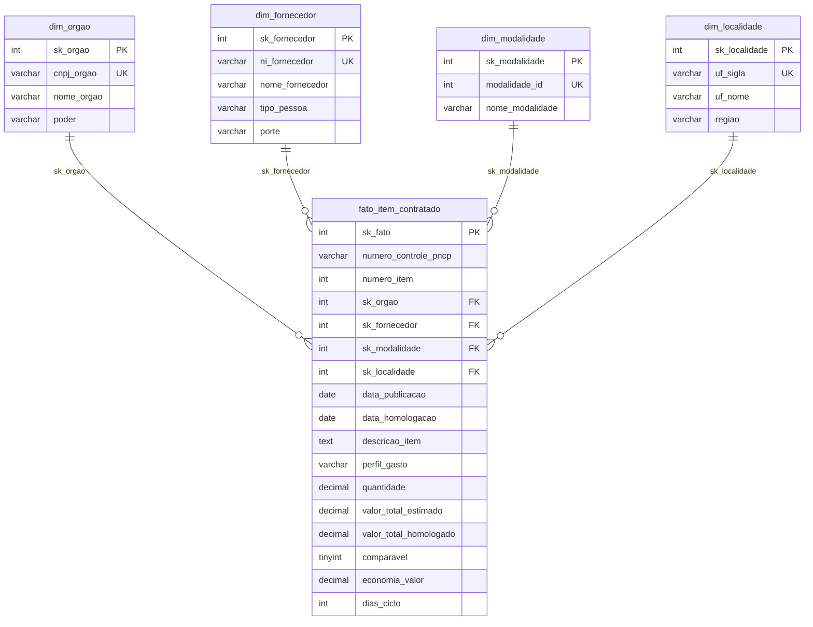
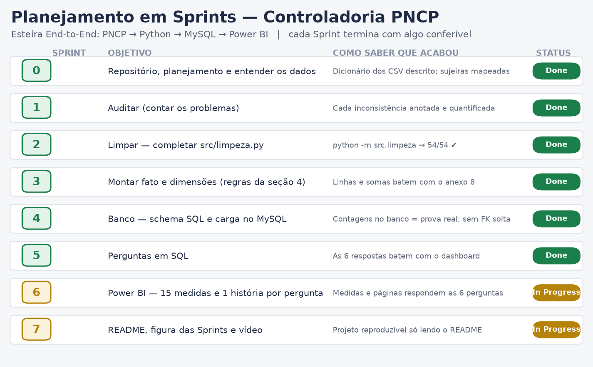

# Análise de Dados com Python + MySQL — Controladoria PNCP

Esteira analítica ponta a ponta (End-to-End) sobre compras e contratações públicas
federais do **Portal Nacional de Contratações Públicas (PNCP)**. O objetivo é
transformar uma base bruta, cheia de inconsistências, em um produto analítico
confiável, auditável e executivo para a Controladoria.

```
PNCP (CSV brutos) → Python (auditoria + limpeza) → MySQL (Star Schema) → Power BI (dashboard)
```

## Contexto do problema

A Controladoria identificou gargalos severos nas compras públicas: indícios de
**sobrepreço**, **concentração** de contratos em grupos econômicos, **morosidade**
entre edital e homologação e **baixa adesão competitiva** em certas modalidades.

Os dados de origem vêm de sistemas legados sem travas de validação: identificadores
corrompidos, valores monetários em texto livre, datas em formatos despadronizados e
inconsistências de cronograma. A missão é liderar uma esteira que entregue à liderança
números em que ela possa confiar para decisão estratégica e auditoria.

- **Fonte:** PNCP / Dados Abertos do Governo Federal (contratações publicadas em 2025).
- **Recorte temporal:** 12 meses consecutivos (02/01/2025 a 31/12/2025).
- **Escopo:** cabeçalho dos certames (órgãos, datas, modalidades) cruzado com os itens
  licitados (valores estimados e homologados, quantidades e descrições).

## Stack

| Camada        | Tecnologia                        | Papel |
|---------------|-----------------------------------|-------|
| Ingestão      | CSV do PNCP (`data/raw/`)         | base bruta, tudo como texto |
| Transformação | Python 3.12 + pandas              | auditoria, limpeza e regras de negócio |
| Armazenamento | MySQL 8.4 (Star Schema)           | 1 fato + 4 dimensões, com integridade |
| Visualização  | Power BI Desktop + DAX            | dashboard executivo (6 perguntas) |

---

## Dicionário das inconsistências tratadas

A base bruta chega "suja". Cada problema abaixo foi auditado e tratado em
`src/limpeza.py` (funções unitárias, testáveis) e aplicado em `src/montar_tabelas.py`.

| # | Problema na base | Exemplo | Tratamento |
|---|------------------|---------|------------|
| 1 | **Documentos (CNPJ/CPF)** com máscara, perda de zero à esquerda e tipos misturados | `11.222.333/0001-81`, `1222333000181`, `ABC123` (estrangeiro) | só dígitos, `zfill` para o tamanho certo (14 PJ / 11 PF), estrangeiro (PE) preservado |
| 2 | **Valores monetários em texto** com `R$`, separadores invertidos e negativos entre parênteses | `R$ 1.234,56`, `1,234.56`, `(1.500,00)` | detecção do decimal pelo símbolo que vem por último; parênteses/sufixo `-` viram negativo |
| 3 | **Separador numérico ambíguo** — ponto ou vírgula sozinho é sempre decimal | `0,754` → `0.754`; `746.815` → `746.815`; `1.234.567` → `1234567` | símbolo repetido = milhar; símbolo único = decimal |
| 4 | **Datas em várias máscaras** e valores impossíveis | `2025-03-10T08:30:00`, `10/03/2025`, `31/02/2025`, `0001-01-01` | tenta formatos conhecidos, descarta hora, só aceita ano 2000–2030 |
| 5 | **Nulos disfarçados** em campos de texto | `N/A`, `NULL`, `-`, `SEM INFORMAÇÃO`, `NÃO SE APLICA` | normalizados para `None` (o `0` só é nulo em texto, nunca em número) |
| 6 | **Encoding quebrado** (UTF-8 lido como Latin-1) | `Aquisição` → `Aquisição` | reencode `latin-1` → `utf-8`; remoção de caracteres invisíveis |
| 7 | **Nomes despadronizados** (órgão, fornecedor, item) | `  Ministério  da   Saúde  ` | caixa alta, espaços colapsados, hífen padronizado |

### Regras de negócio da Controladoria

Além da limpeza técnica, o pipeline aplica as decisões de negócio do enunciado:

- **Grão do fato:** uma linha por item de contratação (`numero_controle_pncp` + `numero_item`).
- **Um vencedor por item:** descarta cancelados; o 1º colocado (menor `ordem_classificacao_srp`,
  vazio = 1) é o vencedor, com desempate pelo menor `sequencial_resultado`.
- **Só itens com resultado** entram no fato (itens sem vencedor ficam de fora).
- **Itens rejeitados:** quantidade/valores ≤ 0, sigiloso, total estimado < R$ 1, homologado
  > 1000× o estimado ou valores acima de R$ 1 trilhão não entram no fato.
- **Comparável:** não é Credenciamento (modalidade 12) **e** razão homologado/estimado entre 0,1 e 10.
  A economia só é medida nos itens comparáveis.
- **Cronologia:** homologação anterior à publicação é impossível → `data_homologacao` fica
  vazia e o item segue no fato sem ciclo.
- **Perfil do gasto:** Bens, Serviços ou Obras e engenharia (palavras-chave de obra têm prioridade).

---

## Modelagem dimensional (Star Schema)

Modelo estrela com **1 fato** no centro e **4 dimensões**, mais o Calendário criado
em DAX no Power BI (a dimensão de tempo). Cada tabela tem chave substituta (`sk_...`)
como PK; as dimensões guardam também a chave natural como `UNIQUE`. A fato aponta para
as dimensões por FK, garantindo integridade referencial.



| Tabela | Papel | Linhas (prova real) |
|--------|-------|---------------------|
| `fato_item_contratado` | o que foi comprado (1 linha por item vencedor) | 6.126 |
| `dim_orgao` | quem comprou (unidade compradora) | 363 |
| `dim_fornecedor` | quem vendeu | 2.652 |
| `dim_modalidade` | como comprou | 7 |
| `dim_localidade` | onde (UF + região) | 27 |

Cada dimensão recebe ainda a linha **"Não informado" (`sk = -1`)**, para que nenhuma
FK do fato fique sem destino. O schema completo está em
[`sql/01_criar_banco.sql`](sql/01_criar_banco.sql), com `CHECK` contra valores negativos
e tipos `DECIMAL` para dinheiro.

---

## Como reproduzir o pipeline

### Pré-requisitos
- Python 3.10+ e MySQL 8.x instalados.
- Dependências Python: `pip install -r requirements.txt`.

### Passo a passo

```bash
# 1. Configurar as credenciais do banco (copie e preencha)
cp .env.example .env          # Windows: copy .env.example .env
#   edite o .env com host, porta, usuário e senha do seu MySQL

# 2. Limpar os dados e montar fato + dimensões (gera data/processed/)
python -m src.limpeza          # autoteste das funções de limpeza: 54/54 ✔
python -m src.montar_tabelas   # grava os CSV tratados e confere com a prova real

# 3. Criar o banco e carregar as tabelas no MySQL
python -m src.carregar         # executa sql/01_criar_banco.sql e carrega em lote

# 4. Responder as 6 perguntas de negócio (no MySQL Workbench ou via CLI)
#    abra e rode sql/02_perguntas.sql
```

Ao rodar `src.montar_tabelas` e `src.carregar`, o próprio script imprime os números de
conferência lado a lado com a **prova real** (anexo 8 do enunciado). Se tudo estiver
certo, eles batem — ver a seção abaixo.

### Estrutura do repositório

```
.
├── README.md
├── requirements.txt
├── .env.example            # modelo de credenciais (o .env real NÃO é versionado)
├── data/
│   ├── raw/                # base bruta do PNCP (compras, itens, resultados)
│   └── processed/          # tabelas tratadas (geradas pelo pipeline)
├── src/
│   ├── config.py           # caminhos e credenciais (lê o .env)
│   ├── banco.py            # conexão e utilitários do MySQL
│   ├── limpeza.py          # funções de limpeza (CNPJ, moeda, datas, nulos)
│   ├── montar_tabelas.py   # regras de negócio → fato + dimensões
│   └── carregar.py         # ingestão em lote no MySQL
├── sql/
│   ├── 01_criar_banco.sql  # schema estrela (DDL)
│   └── 02_perguntas.sql    # as 6 perguntas de negócio
├── powerbi/                # medidas DAX documentadas e o arquivo .pbix
└── docs/img/               # figura das Sprints e apoios visuais
```

### Segurança

A senha do MySQL fica **apenas** no `.env` (bloqueado pelo `.gitignore`). Nunca é
versionada, nem aparece no README, nos scripts ou no vídeo.

---

## Planejamento em Sprints

O trabalho foi dividido em 8 sprints, cada uma com um objetivo claro e **algo
conferível** ao final (um número que bate, um teste que passa). A figura abaixo resume
o quadro; ela é gerada por script (`docs/gerar_sprints.py`) e reflete o andamento real.



| Sprint | Objetivo | Como saber que acabou |
|--------|----------|------------------------|
| 0 | Repositório, planejamento e entender os dados | dicionário dos CSV descrito |
| 1 | Auditar (contar os problemas) | cada inconsistência quantificada |
| 2 | Limpar — completar `src/limpeza.py` | `python -m src.limpeza` → 54/54 ✔ |
| 3 | Montar fato e dimensões (regras da seção 4) | somas batem com a prova real |
| 4 | Banco — schema SQL e carga no MySQL | contagens no banco = prova real |
| 5 | Perguntas em SQL | 6 respostas batem com o dashboard |
| 6 | Power BI — 15 medidas e 1 história por pergunta | páginas respondem as 6 perguntas |
| 7 | README, figura das Sprints e vídeo | projeto reproduzível só lendo o README |

## Prova real (conferência)

O pipeline reproduz exatamente os números esperados pela Controladoria (anexo 8 do
enunciado). Saída real de `python -m src.montar_tabelas`:

| Conferência | Esperado | Obtido |
|-------------|----------|--------|
| Contratações (linhas de `compras.csv`) | 2.042 | 2.042 ✅ |
| Itens (linhas de `itens.csv`) | 7.077 | 7.077 ✅ |
| Resultados (linhas de `resultados.csv`) | 15.896 | 15.896 ✅ |
| Itens rejeitados (inválidos) | 99 | 99 ✅ |
| Itens no fato | 6.126 | 6.126 ✅ |
| Contratações distintas no fato | 1.962 | 1.962 ✅ |
| Fornecedores distintos | 2.652 | 2.652 ✅ |
| Unidades compradoras (CNPJ) | 363 | 363 ✅ |
| Soma do valor total homologado | R$ 8.044.498.805,74 | idem ✅ |
| Itens na base comparável | 5.457 | 5.457 ✅ |
| Economia nominal (base comparável) | R$ 992.861.686,95 | idem ✅ |
| Economia % (base comparável) | 14,46% | 14,46% ✅ |
| Ciclo médio / máximo (dias) | 48,1 / 611 | 48,1 / 611 ✅ |
| Itens sem ciclo | 230 | 230 ✅ |
| Perfil (% do volume homologado) | Obras 60,8 / Serviços 36,6 / Bens 2,6 | idem ✅ |

## Dashboard (Power BI)

O modelo estrela é consumido no Power BI com um Calendário em DAX e **15 medidas**
explícitas. O dashboard tem 6 páginas — uma por pergunta de negócio — com menu de
navegação (bookmarks) e tooltip personalizada.

- Arquivo do relatório: [`powerbi/dashboard.pbix`](powerbi/dashboard.pbix)
- **Visualização em PDF (abre sem o Power BI):** [`docs/dashboard.pdf`](docs/dashboard.pdf)
- Medidas DAX documentadas: [`powerbi/medidas_dax.md`](powerbi/medidas_dax.md)
- Guia de montagem passo a passo: [`powerbi/GUIA_POWERBI.md`](powerbi/GUIA_POWERBI.md)

### As 6 perguntas de negócio
1. **Economia global** — quanto o governo economizou (R$ e %)?
2. **Fornecedores** — quem concentra o orçamento e qual o risco?
3. **Modalidades** — qual economiza mais e qual movimenta mais dinheiro?
4. **Ciclo** — onde as compras demoram mais (dias entre edital e homologação)?
5. **Regional** — onde se gasta mais e onde se consegue mais desconto?
6. **Perfil** — como o dinheiro se divide entre bens, serviços e obras?

As mesmas respostas estão em SQL em [`sql/02_perguntas.sql`](sql/02_perguntas.sql).

## Vídeo (Review de Sprint)

Defesa técnica em vídeo (máx. 7 min): `<inserir link do Google Drive>`.

> Caso o vídeo não seja entregue a tempo, a **defesa técnica escrita** abaixo registra,
> por extenso, o racional de cada ponto que seria apresentado oralmente.

---

## Defesa técnica (escrita)

Esta seção documenta, por escrito, a defesa que seria feita no vídeo. Está organizada
nos quatro eixos da avaliação técnica.

### 1. Defesa da sanitização de dados em Python

O ecossistema de origem (PNCP) entrega dados sem travas de validação, então a limpeza
foi tratada como uma camada de auditoria explícita, com **funções unitárias e testáveis**
em `src/limpeza.py` (autoteste `python -m src.limpeza` → **54/54**). Cada decisão:

- **Documentos (CNPJ/CPF):** removo máscara, fico só com dígitos e recomponho o zero à
  esquerda com `zfill` no tamanho certo (14 para PJ, 11 para PF). Isso corrige o erro
  clássico de CNPJ que "perdeu o zero" e passaria a ser um documento diferente.
  Estrangeiros (tipo `PE`) são preservados, pois não seguem o formato nacional.
- **Conversão de tipos de moeda:** o grande risco era o separador. A regra desta base é
  que **ponto ou vírgula sozinho é sempre decimal** (`746.815` = 746,815), e só o símbolo
  **repetido** é milhar (`1.234.567` = 1.234.567). Quando aparecem os dois, o último é o
  decimal. É exatamente isso que impede o "volume homologado explodir em bilhões":
  o total fecha em **R$ 8,04 bi** (prova real), não em R$ 31 bi.
- **Datas:** há várias máscaras no mesmo campo (`2025-03-10T08:30:00`, `10/03/2025`,
  `20250310`). Tento os formatos conhecidos, descarto a hora e **rejeito datas impossíveis**
  (`31/02/2025`) e anos absurdos (só aceito 2000–2030).
- **Nulos disfarçados:** `N/A`, `NULL`, `-`, `SEM INFORMAÇÃO`, `NÃO SE APLICA` viram
  `None`. Detalhe fino: o `"0"` só é nulo em campo de **texto**; em campo numérico, zero
  é um valor válido (`zero_eh_nulo=False`).
- **Encoding:** conserto o clássico UTF-8 lido como Latin-1 (`Aquisição` → `Aquisição`)
  e removo caracteres invisíveis de largura zero.

O **critério de descarte/rejeição** (regra 4) é a segunda barreira de qualidade: itens
com quantidade/valor ≤ 0, orçamento sigiloso, total estimado < R$ 1, homologado mais de
1000× o estimado ou acima de R$ 1 trilhão **não entram no fato** (99 itens, bate com a
prova real). Isso evita que outliers e lixo contaminem as análises.

### 2. Defesa do produto no Power BI

O dashboard foi desenhado para **responder as 6 perguntas de negócio**, uma página por
pergunta, no padrão *pergunta (título) → números (visuais) → conclusão (texto)*.

- **Modelo:** importação das 5 tabelas do Star Schema via conector MySQL; relações 1:N
  das dimensões para o fato; colunas técnicas (`sk_`) escondidas da visão de relatório.
- **Calendário dinâmico em DAX** (`CALENDAR`), com colunas temporais ordenadas por número
  (o mês ordena por `MesNum`, não alfabeticamente) e **duas relações** com o fato
  (`data_publicacao` ativa; `data_homologacao` inativa via `USERELATIONSHIP`). A hierarquia
  automática de data do Power BI fica **desligada**, como pede o enunciado.
- **15 medidas DAX explícitas** em tabela dedicada (`_Medidas`), com `VAR/RETURN`,
  `CALCULATE`, `DIVIDE` e iteradoras. Percentual é sempre `DIVIDE(soma, soma)`, nunca média
  de percentuais — por isso a Economia % fecha em **14,46%**.
- **UX avançada:** menu retrátil com botões e *bookmarks* para navegar entre as páginas,
  e página de *tooltip* personalizada para detalhamento ao passar o mouse.
- **Princípios CRAP:** contraste e cor com propósito (destacar o indicador-chave de cada
  página), alinhamento em grid, repetição do mesmo layout entre páginas e proximidade
  agrupando número + conclusão.

As medidas e o guia de montagem estão em [`powerbi/medidas_dax.md`](powerbi/medidas_dax.md)
e [`powerbi/GUIA_POWERBI.md`](powerbi/GUIA_POWERBI.md). Os números do dashboard batem com
`sql/02_perguntas.sql` e com a tabela de prova real acima.

### 3. Defesa da arquitetura MySQL (Star Schema)

Escolhi um **esquema estrela** em vez de uma tabela única desnormalizada porque o problema
é analítico (agregações por órgão, fornecedor, modalidade, UF e tempo) — e a estrela
entrega consultas simples, consistentes e com integridade garantida pelo banco.

- **1 fato + 4 dimensões:** o fato guarda os números (o que se mede) e as chaves; cada
  dimensão guarda a descrição (quem, como, onde). O tempo é a dimensão Calendário (DAX).
- **Chaves substitutas (`sk_`)** como PK em todas as tabelas, e a chave natural
  (`cnpj_orgao`, `ni_fornecedor`, `modalidade_id`, `uf_sigla`) como `UNIQUE`. Isso
  desacopla o modelo da origem e evita duplicação por máscara/zero perdido.
- **Integridade referencial:** toda FK do fato aponta para uma linha que existe. Para
  nenhuma FK ficar solta, cada dimensão tem a linha **"Não informado" (`sk = -1`)**
  (neste dataset nenhuma linha do fato precisou dela — 0 referências, o que confirma a
  qualidade da limpeza).
- **Tipos e barreira de qualidade:** dinheiro em `DECIMAL(18,2)`, preços/quantidades em
  `DECIMAL(18,4)`, datas em `DATE`; `CHECK` impede valores monetários negativos. O banco
  é a segunda barreira de validação, depois do Python.
- **Pipeline de carga automatizado:** `src/carregar.py` executa o DDL
  (`sql/01_criar_banco.sql`), carrega as dimensões **antes** do fato (por causa das FKs),
  insere em lote (`executemany`) e **confere as contagens** contra a prova real
  (fato 6.126, dims 363/2.652/7/27). Rollback natural: o DDL recria o schema do zero a
  cada execução, tornando a carga idempotente.

### 4. Comunicação técnica e rastreabilidade

- **Rastreabilidade por commits:** o histórico do Git foi construído para contar a
  evolução (um passo por commit, mensagens no imperativo), seguindo as Sprints 0→7.
- **Reprodutibilidade:** qualquer analista reproduz o pipeline do zero só com o README
  (seção "Como reproduzir"), e cada etapa imprime os números de conferência.
- **Confiabilidade demonstrável:** a tabela de prova real mostra os 15 indicadores
  batendo com o anexo do enunciado — a evidência objetiva de que o pipeline está correto.
- **Decisões documentadas:** as regras de negócio e o dicionário de inconsistências ficam
  no README; divergências de interpretação (quando houver) seriam anotadas aqui, como
  manda o enunciado.

## Melhorias futuras
- Automatizar a atualização incremental da base (novos meses do PNCP) sem recarga total.
- Alertas de sobrepreço por item (homologado acima do estimado) direto no dashboard.
- Testes automatizados end-to-end comparando o banco com a prova real em CI.

---

> **Status:** backend (Python + MySQL + SQL) completo e validado contra a prova real;
> defesa técnica registrada por escrito. Pendentes: montagem do `.pbix` e gravação do vídeo.
